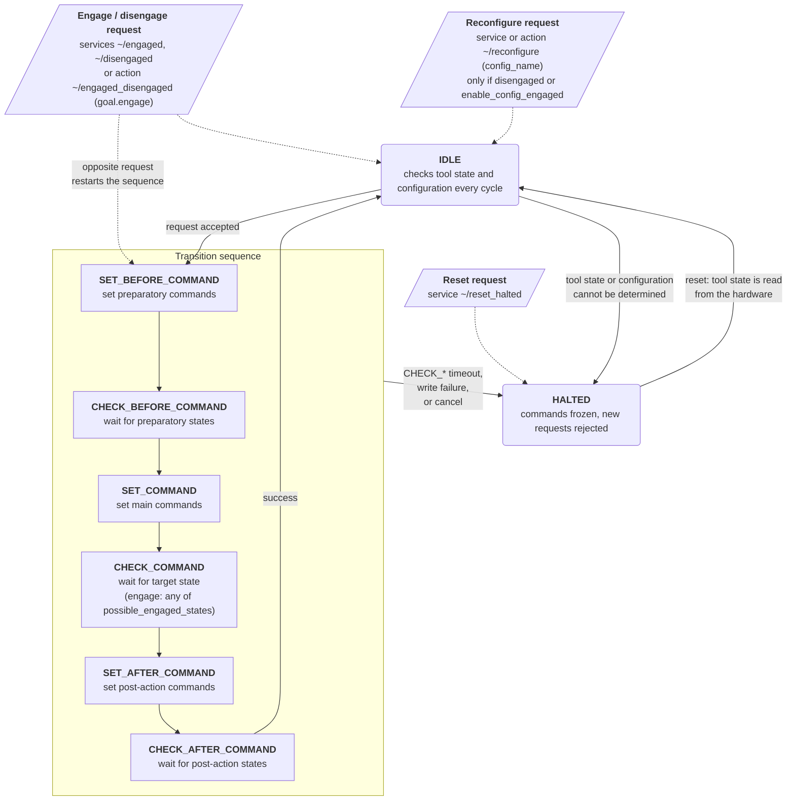

State machine of the `gpio_tool_controller`.
Solid arrows are transitions, dashed arrows are requests from the ROS 2 interface.
Service and action names use the default values of `engaged.name` (`engaged`) and `disengaged.name` (`disengaged`).

